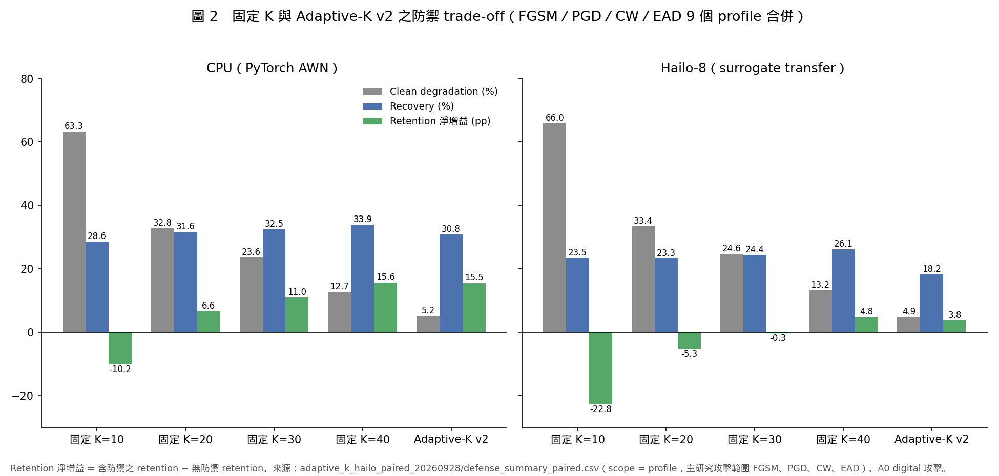
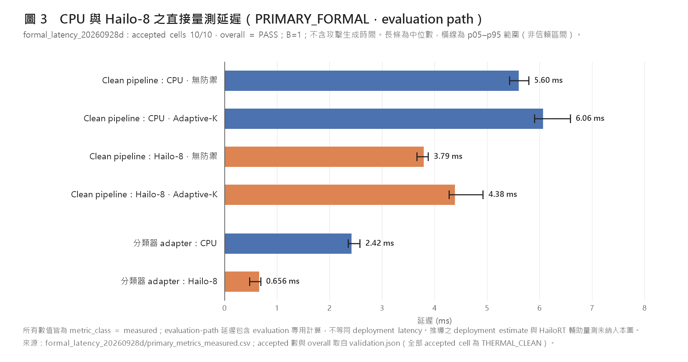

# 執行摘要：Adaptive-K 防禦、CPU／Hailo-8 正式延遲與 Pi 5 攻擊生成延遲探索性量測

**報告日期**：2026-09-28　｜　**涵蓋期間**：2026-09-21 checkpoint 之後至 2026-09-28　｜　**平台**：Raspberry Pi 5 ＋ Hailo-8　｜　**資料集**：RadioML 2016.10a

所有數值取自 `meeting_20260928_evidence/results/` 內各實驗的 validation 與彙總檔。完整分析見 [`meeting_report.md`](meeting_report.md)，稽核紀錄見 [`analysis/evidence_audit.md`](analysis/evidence_audit.md)。

**威脅模型**：與 0921 報告相同，為 A0 digital classifier-input attack。Hailo-8 端的攻擊為 surrogate-model transfer attack（對抗樣本由 PyTorch AWN 生成），不是針對量化模型的白箱攻擊。

## 主要結果

| # | 結果 | 數值 | 來源 |
|---|---|---|---|
| 4 | **Adaptive-K parity** | 真實資料（2200 clean、264 attacked）之決策差異為 0；此 PASS 是在 batch vs N=1 gate 由 bitwise 條件改為決策＋容差條件後取得（第一次 run 為 FAIL） | `adaptive_k_parity_20260927_{160808,162249}` |
| 5 | **Adaptive-K 效果（CPU，FGSM／PGD／CW／EAD 9 profile 合併）** | Clean degradation 5.24%（K=40：12.71%）；retention 57.80%；淨增益 +15.49 pp（K=40：+15.61 pp） | `adaptive_k_effectiveness_20260927_164906`、`adaptive_k_hailo_paired_20260928`（scope = profile） |
| 6 | **Adaptive-K 效果（Hailo-8 配對，9 profile 合併）** | Clean degradation 4.91%（為各防禦最低）；recovery 18.19%（K=40：26.09%）；淨增益 +3.79 pp（K=40：+4.81 pp） | `adaptive_k_hailo_paired_20260928` |
| 7 | **正式延遲（量測值）** | Hailo adapter 0.656 ms vs CPU adapter 2.42 ms（中位；配對差 −1.76 ms，440/440）；clean pipeline（evaluation path）CPU 5.60 ms、Hailo 3.79 ms；加上 Adaptive-K 後為 6.06、4.38 ms | `formal_latency_20260928d`（PRIMARY_FORMAL，10/10 accepted） |
| 8 | **正式延遲（推導值與輔助值）** | Deployment estimate（推導，非量測）：Hailo 3.63 ms、CPU 5.42 ms；HailoRT HW latency（輔助、非配對）0.17 ms | 同上 |

## 探索性 latency 觀察（不列為主要結果）

Pi 5 上 B=1 攻擊生成延遲之量測（報告 §3）為探索性 latency observation，不構成攻擊加速結論：

- PyTorch backend toggle（僅於 PGD／BIM 攻擊呼叫期間關閉 oneDNN／mkldnn）：中位 PGD 42.53 → 36.33 ms、BIM 43.84 → 37.63 ms（88 樣本、熱控制、8/8 對）。此為單一平台（ARM64）、單一 torch 版本、B=1 之觀察，不足以建立 ARM 平台之一般性 acceleration claim，亦不可跨平台泛化。`b1_pgd_bim_mkldnn_off` 為預設關閉之實驗選項，正式 CPU full matrix 未使用（`accel_phase1d3_mkldnn_b1_20260927_135420`、`accel_phase1_final_integration_20260927_153520`）。
- Batching：PGD／BIM 之 throughput 比最高 5.16×（BIM B=32 intra4），但批次完成時間皆高於 40 ms，不降低單樣本決策延遲（`accel_phase1c_v2_formal_20260926_164547`）。

## 圖表

| | |
|---|---|
|  |  |
| **圖 2**　固定 K 與 Adaptive-K 之 trade-off（CPU／Hailo-8 分列） | **圖 3**　直接量測延遲（PRIMARY_FORMAL） |

圖 1（mkldnn ON／OFF 之 B=1 攻擊延遲）為探索性 backend-toggle 量測，見報告 §3.7。

## 結論

1. 在 FGSM／PGD／CW／EAD 9 個 profile 合併下，Adaptive-K 在 CPU 上以最低的 clean 代價得到與 K=40 相近的淨增益；在 Hailo-8 上 clean 代價仍最低，但淨增益低於 K=40。防禦的相對優劣依部署 backend 而異。以上為演算法與實驗驗證；本機 repository 的 main pipeline（`src/utils/pipeline.py`、`TopKAdapter`）尚未接入 Adaptive-K。
2. 正式延遲量測區分量測值、配對統計、推導估計與輔助硬體量測；Hailo pipeline 中 host 端 sensing 仍佔主要時間。

## 主要限制

- 攻擊生成延遲之量測為探索性，只涵蓋 3 種攻擊與 88 樣本；backend toggle 結果不推論至其他平台。
- Adaptive-K parity 的 PASS 依賴修訂後的 gate；batched 與 N=1 輸出並非 bitwise 相同。
- 延遲 benchmark 只涵蓋 5 個 block，不含攻擊生成；Hailo 端溫度無法讀取。
- 詳見 [`meeting_report.md` §9](meeting_report.md#9-限制與有效性威脅)；研究工作 traceability 與後續工作見 §10、§11。
