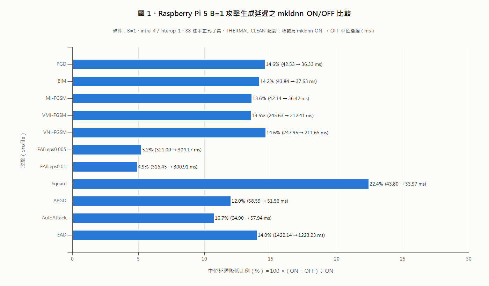
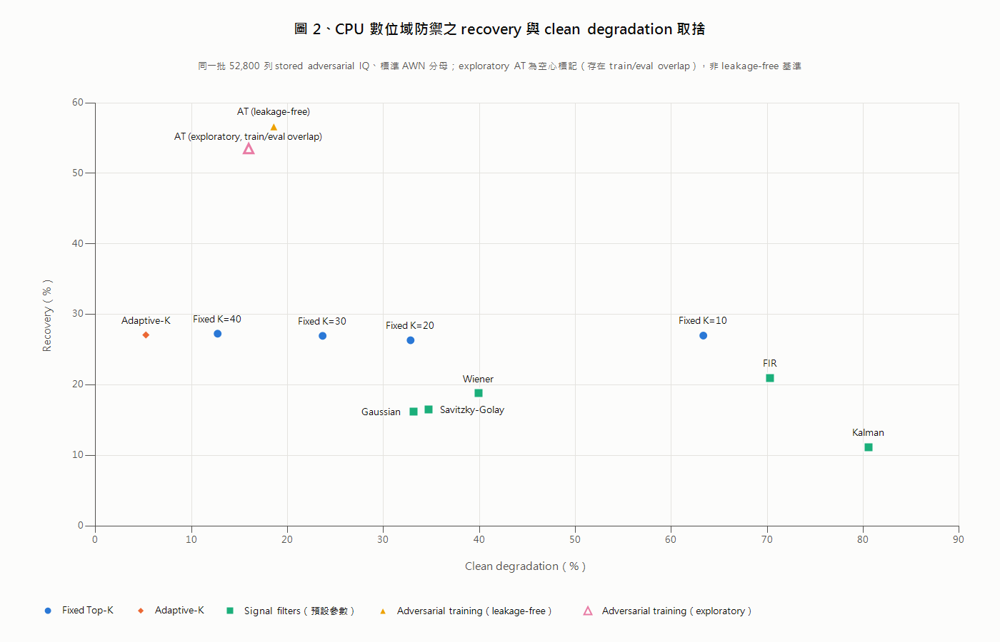
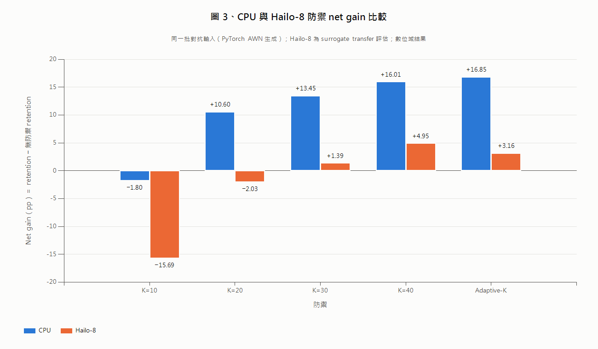

# 研究進度報告

**報告日期**：2026-10-05　｜　**平台**：Raspberry Pi 5 CPU 與 Hailo-8　｜　**資料集**：RadioML 2016.10a　｜　**分類器**：AWN

> 本報告數值取自 `data/` 內各 CSV，該等 CSV 由 repository `results/` 中各實驗之 summary、validation 與 manifest 檔產生；每一來源檔之路徑與 SHA-256 列於 `data/SOURCE_MANIFEST.csv`，查核用之精簡副本位於 `review_evidence/`。

## 1. 本階段研究目的

本階段研究聚焦於下列五項：

1. **Adversarial attack 執行效率**：在 Raspberry Pi 5、單一樣本（B=1）條件下，評估各正式攻擊之生成延遲可否在不改變攻擊語意的前提下降低。
2. **Adaptive-K defense**：以相同的已儲存對抗輸入與相同分母，評估 Adaptive-K 相對於固定 K 之 recovery 與 clean degradation。
3. **Hailo backend**：評估同一批對抗輸入與防禦在 Hailo-8 推論 backend 上的行為。
4. **Defense comparison**：在相同分母下比較固定 Top-K、Adaptive-K、五種傳統訊號濾波器與 adversarial training。
5. **Leakage-free adversarial training**：建立訓練資料排除全部正式評估樣本的 adversarial training 模型，作為正式比較基準。

## 2. 系統與實驗範圍

| 項目 | 設定 |
|---|---|
| 資料集 | RadioML 2016.10a；正式網格 11 種調變 × 20 個 SNR（−20 至 18 dB）× sample_index 0–9，共 2,200 個 clean 樣本 |
| 分類器 | AWN（PyTorch checkpoint；Hailo-8 使用編譯後 HEF `awn_2016_10a_c5.hef`） |
| 攻擊 | 正式攻擊設定共 17 種攻擊、24 個 profile（`configs/hailo_full_matrix.json`）；attack generation 一律使用可微分之 CPU AWN |
| 運算平台 | Raspberry Pi 5 CPU（torch 2.14.0+cpu）；Hailo-8 僅作為推論 backend |
| 威脅層級 | A0 數位域：擾動直接作用於記憶體中的 AWN 輸入 IQ |
| 範圍限制 | 本階段結果均為 digital-domain 驗證，**不是 OTA／RF validation** |

## 3. Attack execution acceleration

**方法**：僅在攻擊呼叫 `atk(x, y)` 期間停用 oneDNN（mkldnn），其餘推論與前後處理維持預設；條件為 B=1、intra 4／interop 1、正式 88 樣本子集、溫度控制（僅 THERMAL_CLEAN cell 納入統計）、每個 profile 8 組 ON／OFF 相鄰配對。整合條件為：8/8 配對 OFF 較快、配對中位減少量至少 1 ms 且至少為 baseline 中位之 1%、SEMANTIC_DIFFERENT = 0、INVALID = 0、benchmark 路徑與 production `AttackAdapter.apply()` 輸出在 88/88 樣本完全一致。

| 攻擊（profile） | mkldnn ON → OFF 中位（ms） | 配對差中位（ms） | OFF 較快配對 | 處置 |
|---|---|---|---|---|
| PGD（eps0.03） | 42.53 → 36.33 | −6.20 | 8/8 | 已整合（`b1_pgd_bim_mkldnn_off`） |
| BIM（eps0.03） | 43.84 → 37.63 | −6.19 | 8/8 | 已整合（`b1_pgd_bim_mkldnn_off`） |
| MI-FGSM | 42.14 → 36.42 | −5.66 | 8/8 | 整合（extended） |
| DI-FGSM | 44.42 → 38.61 | −6.82 | 8/8 | 整合（extended） |
| VMI-FGSM | 245.63 → 212.41 | −33.22 | 8/8 | 整合（extended） |
| VNI-FGSM | 247.95 → 211.65 | −34.47 | 8/8 | 整合（extended） |
| RFGSM | 42.70 → 36.05 | −6.72 | 8/8 | 整合（extended） |
| TPGD | 46.37 → 39.35 | −6.72 | 8/8 | 整合（extended） |
| CW | 43.97 → 39.10 | −4.86 | 8/8 | 整合（extended） |
| FAB eps0.005（targeted rerun） | 321.00 → 304.17 | −16.76 | 8/8 | 整合（extended） |
| FAB eps0.01（targeted rerun） | 316.45 → 300.91 | −15.87 | 8/8 | 整合（extended） |
| FAB eps0.03 | 330.63 → 312.47 | −18.32 | 8/8 | 整合（extended） |
| Square | 43.80 → 33.97 | −9.48 | 8/8 | 整合（extended） |
| APGD | 58.59 → 51.56 | −7.58 | 8/8 | 整合（extended） |
| APGD-T | 66.48 → 57.58 | −8.97 | 8/8 | 整合（extended） |
| AutoAttack（targeted rerun） | 64.90 → 57.94 | −7.50 | 8/8 | 整合（extended） |
| EAD | 1422.14 → 1223.23 | −207.60 | 8/8 | 整合（extended） |
| FGSM（4 個 eps） | 5.28–5.36 → 4.68–4.86 | −0.49 至 −0.62 | 8/8 | 保留原執行路徑（收益低於整合門檻） |
| DeepFool | 不適用（pre-validation 未通過） | 不適用 | 不適用 | 保留原執行路徑（未通過語意一致性門檻） |

整合之 profile 其 sign test 雙尾 p 值均為 0.0078（8/8）。

- **FGSM**：OFF 在 8/8 配對中較快，但配對中位減少量為 0.49–0.62 ms，低於 1 ms 實用門檻，因此不納入 mkldnn-off 加速路徑，維持原執行方式。
- **DeepFool**：pre-validation 之 88 個樣本中，1 個 bit-identical、85 個位元不同但攻擊後預測與 attack success 相同、2 個 SEMANTIC_DIFFERENT，full run 與 targeted rerun 結果相同。兩個樣本為 `sample_pos` 25（BPSK、snr_db −20、sample_index 1）與 `sample_pos` 37（CPFSK、snr_db 6、sample_index 1）；ON 輸出之 top-1 與 top-2 logit 差分別為 5.96×10⁻⁸ 與 4.77×10⁻⁷，ON／OFF 輸出最大絕對差為 1.86×10⁻⁹。由實驗紀錄可知，這兩個輸出位於極接近分類決策邊界的數值敏感區域，切換 mkldnn 後攻擊後預測不同，不符合整合條件，因此不納入 mkldnn-off 加速路徑，維持原執行方式。
- **FAB／AutoAttack targeted rerun**：full run 中 FAB eps0.005／eps0.01 因溫度條件未能取得足夠 THERMAL_CLEAN cell；AutoAttack 因未指定 seed 時子攻擊 seed 取自系統時間，production 與 benchmark 路徑輸出僅 87/88 一致。Targeted rerun 以相同方法僅重跑這些 profile，AutoAttack 並於 benchmark 範圍內以每列 formal seed 固定上述 seed；實驗結果為三個 profile 各 16 個 planned cell 全部為 THERMAL_CLEAN、anchor 一致性 88/88、SEMANTIC_DIFFERENT 0、INVALID 0。

**適用範圍**：上述延遲數值僅適用於目前 Raspberry Pi 5、B=1、intra 4／interop 1、torch 2.14.0+cpu 之執行設定。AutoAttack 延遲分佈具重尾（p95 為 15932.7 → 12301.1 ms），表中以中位數表示。

**圖 1、Raspberry Pi 5 B=1 攻擊生成延遲之 mkldnn ON/OFF 比較**　橫軸為中位延遲降低比例，由 mkldnn ON 與 OFF 之 pooled 中位延遲計算（100 ×（ON − OFF）÷ ON），各橫條標籤列出原始 ON → OFF 中位延遲。因各攻擊之延遲量級相差逾 30 倍（MI-FGSM 約 42 ms、EAD 約 1422 ms），圖中以比例呈現，未截斷任何資料。比較結果指出，在目前實驗設定下各代表性攻擊之降低比例介於 4.9%（FAB eps0.01）與 22.4%（Square）之間；DeepFool 未通過 pre-validation、FGSM 未達整合門檻，故未列入。圖資料：`figure_sources/fig1_attack_acceleration.csv`；primary evidence：`review_evidence/01_attack_accel/accel_phase1d3_mkldnn_b1_20260927_135420/validation.json`、`review_evidence/01_attack_accel/attack_b1_accel_full_20261004_100032/b1_acceleration_summary.csv`、`review_evidence/01_attack_accel/attack_b1_accel_full_20261004_174620/b1_acceleration_summary.csv`。

## 4. Extended attack integration validation

`AttackAdapter(b1_mkldnn_off_extended=True)` 為明確 opt-in 選項，預設關閉，僅作用於 B=1 之 `atk(x, y)`。整合驗證使用 88 個正式樣本，option OFF 與修改前 `AttackAdapter` 逐位元比較，option ON 與 option OFF 比較攻擊語意；AutoAttack 於驗證中以 production 參數 `attack_params["seed"]` 設為每列 formal seed。

| 類別 | Profile | BIT_IDENTICAL | 位元不同、語意相同 | SEMANTIC_DIFFERENT | INVALID |
|---|---|---|---|---|---|
| Extended | MI-FGSM、DI-FGSM、VMI-FGSM、RFGSM、Square、APGD、APGD-T、AutoAttack | 各 88 | 0 | 0 | 0 |
| Extended | VNI-FGSM | 85 | 3 | 0 | 0 |
| Extended | TPGD | 86 | 2 | 0 | 0 |
| Extended | CW | 12 | 76 | 0 | 0 |
| Extended | FAB eps0.005／eps0.01／eps0.03 | 67／54／12 | 21／34／76 | 0 | 0 |
| Extended | EAD | 9 | 79 | 0 | 0 |
| Control（選項不套用） | FGSM ×4、PGD ×3、BIM、DeepFool | 各 88 | 0 | 0 | 0 |

驗證結果為 overall PASS、失敗項目 0，共 13 種攻擊納入 production extended set。FGSM、PGD、BIM 與 DeepFool 在 extended 選項開啟時輸出不變；PGD 與 BIM 由獨立的 `b1_pgd_bim_mkldnn_off` 控制，其整合驗證結果同為 PASS。

## 5. Defense comparison on CPU

所有防禦於同一批已儲存之對抗輸入（24 個 profile × 2,200 個樣本 = 52,800 列）上評估，分母一律為標準 AWN 之 clean_correct（31,152）與 attack success（20,960）。標準 AWN 之 clean accuracy 為 59.00%、attacked accuracy 為 30.73%、Conditional Attack Success Rate 為 67.28%。

定義：recovery = recovered ÷ attack success；clean degradation = clean 正確但防禦後錯誤之數量 ÷ clean_correct；retention = clean 正確且防禦後正確 ÷ clean_correct；net gain = retention − 無防禦 retention。

| 防禦 | Recovery（%） | Clean degradation（%） | Retention（%） | Net gain（pp） | Defended accuracy（%） |
|---|---|---|---|---|---|
| 無防禦 | 0.00 | 0.00 | 32.72 | 0.00 | 30.73 |
| 固定 K=10 | 27.00 | 63.33 | 30.91 | −1.80 | 25.78 |
| 固定 K=20 | 26.34 | 32.82 | 43.32 | +10.60 | 34.31 |
| 固定 K=30 | 26.96 | 23.65 | 46.17 | +13.45 | 36.16 |
| 固定 K=40 | 27.27 | 12.71 | 48.72 | +16.01 | 37.34 |
| Adaptive-K | 27.08 | 5.24 | 49.57 | +16.85 | 36.96 |
| Kalman filter | 11.15 | 80.59 | 15.78 | −16.93 | 15.64 |
| Wiener filter | 18.78 | 39.91 | 35.92 | +3.20 | 30.89 |
| Savitzky-Golay filter | 16.47 | 34.67 | 36.05 | +3.33 | 31.30 |
| Gaussian filter | 16.15 | 33.13 | 36.10 | +3.39 | 31.20 |
| FIR filter | 20.94 | 70.26 | 25.28 | −7.43 | 23.54 |
| Adversarial training（exploratory） | 53.53 | 15.95 | 66.79 | +34.07 | 45.70 |
| Adversarial training（leakage-free） | 56.67 | 18.57 | 68.62 | +35.90 | 46.65 |

比較結果指出，Adaptive-K 之 recovery 與固定 K（26.34–27.27%）相近，clean degradation 為各訊號處理類防禦中最低（5.24%），net gain 為 +16.85 pp。五種傳統濾波器使用其原始實作之預設參數，未針對本管線調整，recovery 為 11.15–20.94%，clean degradation 為 33.13–80.59%。

**圖 2、CPU 數位域防禦之 recovery 與 clean degradation 取捨**　橫軸為 clean degradation，縱軸為 recovery，所有點使用相同之已儲存對抗輸入與標準 AWN 分母。可觀察到不同方法在 recovery 與 clean cost 之間呈現不同取捨：固定 K 之 recovery 相近而 clean degradation 隨 K 減少而上升；Adaptive-K 位於低 clean degradation 區域；adversarial training 之 recovery 較高，clean degradation 介於 Adaptive-K 與多數濾波器之間；五種濾波器（預設參數）之 recovery 較低。Exploratory AT 以空心標記表示，其訓練集與評估樣本存在重疊，不作為 leakage-free 基準。此圖不代表一般性的方法優劣排序。圖資料：`figure_sources/fig2_cpu_defense_tradeoff.csv`；primary evidence：`review_evidence/03_defense_recovery_cpu/defense_recovery_full_20261004_215947/defense_recovery_summary.csv`、`review_evidence/04_adversarial_training/defense_recovery_full_20261005_152728/defense_recovery_summary.csv`。

**Exploratory adversarial training 標示**：exploratory 列使用既有 checkpoint `2016.10a_AWN_at.pkl`，其訓練資料以 SNR ≥ 0 dB 全體資料隨機切分，2,200 個正式評估樣本中有 928 個位於其訓練集，存在 training／evaluation overlap，其訓練攻擊設定亦非本專案正式 profile。此列僅供參考，不作為正式 leakage-free baseline；正式基準見第 6 節。

## 6. Leakage-free adversarial training

**訓練設定與結果**

| 項目 | 值 |
|---|---|
| 架構與初始權重 | 同 AWN 架構；以正式 AWN checkpoint 初始化（SHA-256 前綴 `8af0458f2570`） |
| 訓練資料 | SNR 0–18 dB；全部調變與 SNR 之 sample_index 0–9（正式評估樣本）排除於 train 與 validation |
| n_train／n_val | 92,565／16,335 |
| 訓練攻擊 | FGSM eps0.03 與 PGD eps0.03（取自正式 profile） |
| 訓練 epoch | 27（early stopping；best epoch = 19） |
| Validation clean accuracy | 89.50% |
| Validation robust accuracy（FGSM eps0.03） | 68.91% |
| Weighted validation | 0.7921 |
| 模型 SHA-256 前綴 | `e3cdc7dd108a` |

**正式 leakage-free transfer evaluation**（對抗輸入由標準 AWN 生成，再由 AT 模型分類；分母與第 5 節相同）

| 指標 | 值 |
|---|---|
| Recovery | 56.67%（95% CI 55.99–57.33%；11,877 ÷ 20,960） |
| Clean degradation | 18.57% |
| Retention | 68.62% |
| Net gain | +35.90 pp |
| Defended accuracy | 46.65% |
| AT 模型 clean accuracy | 50.73% |
| 評估樣本與訓練資料重疊 | 0 / 2,200 |

**與 Adaptive-K 之取捨**：在相同分母下，leakage-free AT 的 recovery（56.67%）與 net gain（+35.90 pp）高於 Adaptive-K（27.08%、+16.85 pp），但 clean degradation 亦較高（18.57% 對 5.24%），AT 模型之 clean accuracy 為 50.73%，低於標準 AWN 之 59.00%，且需要重新訓練模型。Adaptive-K 之 recovery 較低，但 clean degradation 較小且不需重新訓練。兩者代表不同的 recovery 與 clean cost 取捨，本結果不支持一般性的優劣排序。

## 7. Hailo paired defense evaluation

對抗輸入與第 5 節相同（由 PyTorch AWN 生成），於 Hailo-8 backend 進行分類，屬 surrogate transfer 評估。Hailo-8 之 clean accuracy 為 54.64%，Conditional Attack Success Rate 為 51.66%；配對驗證之所有 gate 結果為 PASS。

| 防禦 | Hailo recovery（%） | Hailo clean degradation（%） | Hailo net gain（pp） | CPU recovery（%） | CPU clean degradation（%） | CPU net gain（pp） |
|---|---|---|---|---|---|---|
| 固定 K=10 | 22.24 | 65.97 | −15.69 | 27.00 | 63.33 | −1.80 |
| 固定 K=20 | 19.24 | 33.36 | −2.03 | 26.34 | 32.82 | +10.60 |
| 固定 K=30 | 20.24 | 24.63 | +1.39 | 26.96 | 23.65 | +13.45 |
| 固定 K=40 | 21.17 | 13.23 | +4.95 | 27.27 | 12.71 | +16.01 |
| Adaptive-K | 14.11 | 4.91 | +3.16 | 27.08 | 5.24 | +16.85 |

**研究解讀**：CPU 與 Hailo-8 之防禦排序不完全一致。以 net gain 排序，CPU 上為 Adaptive-K 最高，Hailo-8 上為固定 K=40 最高；以 recovery 排序，Adaptive-K 在 CPU 上與固定 K 相近，在 Hailo-8 上則為五者最低。兩個 backend 之 clean degradation 差距在 2.7 pp 以內，recovery 差距較大（例如 Adaptive-K 為 27.08% 對 14.11%）；net gain 另受兩個 backend 無防禦 retention 不同（CPU 32.72%、Hailo-8 48.34%）之影響。此差異之成因目前尚未分析，backend-specific 的防禦行為值得後續研究。本節結果為數位域 transfer 評估，不代表實體射頻環境下的穩健性。

**圖 3、CPU 與 Hailo-8 防禦 net gain 比較**　單一縱軸為 net gain（pp），零基準線以上為相對無防禦之 retention 增加。同一組固定 K 與 Adaptive-K 在 CPU 與 Hailo-8 上之 net gain 排序不完全一致（CPU 上 Adaptive-K 最高，Hailo-8 上固定 K=40 最高），結果支持進一步分析 backend-specific behavior；此差異之成因需進一步分析。Hailo-8 結果為 surrogate transfer 之數位域評估。圖資料：`figure_sources/fig3_cpu_hailo_defense_comparison.csv`；primary evidence：`review_evidence/05_hailo_paired/adaptive_k_hailo_paired_20260928/defense_summary_paired.csv`（scope = overall）。

## 8. Main pipeline integration status

| 功能 | 介面 | 行為 | 驗證結果 |
|---|---|---|---|
| CPU／Hailo-8 推論 backend | `--inference-backend {cpu,hailo}`、`--hef-path` | 預設 CPU；Hailo-8 需明確指定 HEF；attack generation 固定使用 CPU AWN；無 silent fallback | 34 PASS／0 FAIL（interactive validation） |
| 固定 Top-K／Adaptive-K | `--use-real-topk`、`--topk-mode {fixed,adaptive}` | 預設 fixed；adaptive 需明確指定並直接呼叫 production 實作；無 silent fallback | 55 PASS／0 FAIL（interactive validation） |
| Attack B=1 mkldnn 選項 | `b1_pgd_bim_mkldnn_off`、`b1_mkldnn_off_extended` | 兩者皆為明確 opt-in，預設關閉，僅作用於 B=1 之攻擊呼叫 | PGD／BIM 與 extended 13 attacks 驗證皆為 PASS |

Adaptive-K 與 Hailo-8 兩組 pipeline 驗證為 interactive validation，於 Raspberry Pi 執行完成，僅使用暫存目錄，未保存 persistent result artifact。

## 9. 目前研究結論

1. 在 Raspberry Pi 5、B=1 之目前設定下，僅於攻擊呼叫期間停用 mkldnn，15 個攻擊（PGD、BIM 與 13 個 extended attacks）之生成延遲中位數降低 4.9%（FAB eps0.01）至 22.4%（Square），且驗證結果未出現攻擊語意改變；FGSM 之收益低於實用門檻，DeepFool 未通過語意一致性門檻（位於決策邊界附近之數值敏感區域），兩者皆不納入 mkldnn-off 加速路徑，維持原執行方式。
2. 在 CPU 數位域評估中，Adaptive-K 之 recovery 與固定 K 相近，而 clean degradation 為訊號處理類防禦中最低；五種傳統濾波器在預設參數下之 net gain 介於 −16.93 至 +3.39 pp。
3. Leakage-free adversarial training 在 transfer 評估下之 recovery 與 net gain 高於 Adaptive-K，但伴隨較高之 clean degradation 與較低之 clean accuracy；兩者呈 recovery 與 clean cost 之取捨。
4. Hailo-8 backend 上之防禦排序與 CPU 不完全一致，防禦效果可能具有 backend 相依性，需進一步分析。

## 10. 研究限制

1. **Digital-domain only**：全部結果屬 A0 數位域，擾動直接作用於 AWN 輸入 IQ，未經空中傳輸或實體射頻通道。
2. **Transfer evaluation**：AT 結果為 transfer 評估（對抗輸入由標準 AWN 生成），並非針對 AT 模型本身之 adaptive white-box robustness；其他防禦亦以未考慮防禦存在之攻擊評估。
3. **訓練與評估攻擊之方法重疊**：leakage-free AT 之訓練攻擊（FGSM eps0.03、PGD eps0.03）屬於 24 個評估 profile 之一部分，樣本雖不重疊，攻擊方法有重疊。
4. **AT clean accuracy cost**：AT 模型 clean accuracy 為 50.73%，低於標準 AWN 之 59.00%；AT 訓練資料僅涵蓋 SNR ≥ 0 dB。
5. **Hailo 為 backend-specific evaluation**：結果僅適用於目前 HEF 與 Hailo-8 量化模型，且為 surrogate transfer。
6. **延遲範圍**：latency 結果僅適用於目前 Raspberry Pi 5、B=1 與 thread／backend 設定。
7. **擾動量不可換算為 RF 量**：數位域擾動大小（eps）不可直接換算為 RF 功率、SIR 或 SNR。
8. **傳統濾波器參數**：五種濾波器使用原始實作之預設參數，未針對本管線調整。
