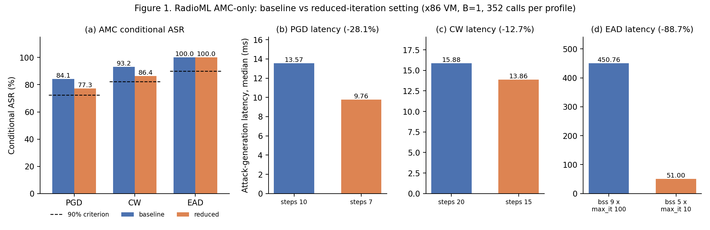
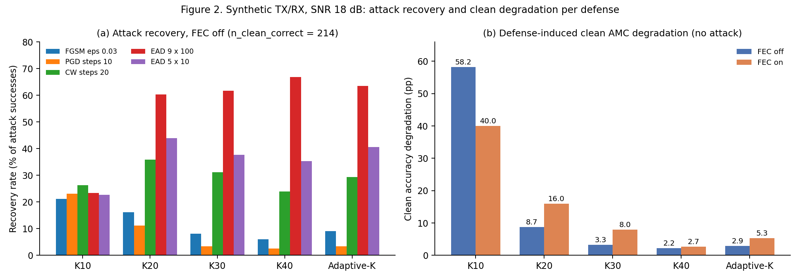
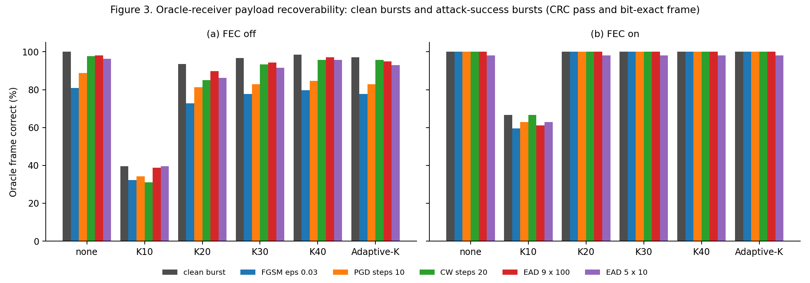
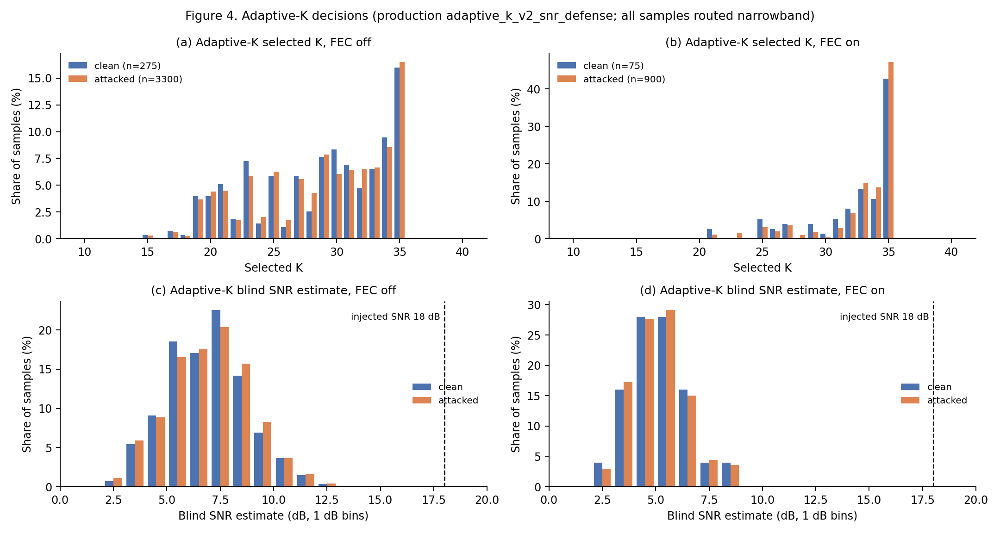
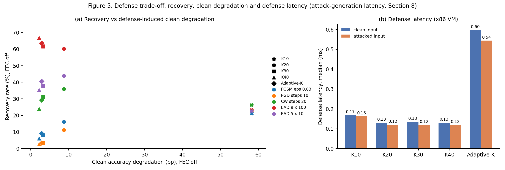

# Reduced-Iteration 對抗攻擊、Payload Recoverability 與頻域防禦之評估

**攻擊**：FGSM、PGD、CW、EAD　｜　**分類器**：AWN　｜　**防禦**：Fixed Top-K（K = 10、20、30、40）、Adaptive-K　｜　**資料域**：RadioML 2016.10a（AMC-only）、synthetic TX/RX（CRC-8 與卷積碼 FEC）

> 本報告之數值均取自 `data/` 內 CSV；各 CSV 之每一列記錄其來源檔（`source_file`），來源檔之路徑、大小與 SHA-256 列於 `data/source_manifest.csv`。五個來源 run 之 validation 均為 PASS。本資料夾由 `scripts/build_reduced_iteration_crc_fec_defense_study.py` 自原始 results 重新產生。

## 1. 研究目的

本研究針對四種以受限擾動或降低擾動為設計目標的對抗攻擊（FGSM、PGD、CW、EAD），探討下列問題：

1. **RQ1**：降低 iterations／steps 後，攻擊對 AMC 之 conditional attack success rate（conditional ASR）是否維持於定義之效力準則內。
2. **RQ2**：reduced-iteration setting 可降低之 attack-generation latency。
3. **RQ3**：攻擊成功誤導 AMC 後，以真實調變解調之 oracle receiver 能否正確恢復 payload。
4. **RQ4**：FEC-enabled decoding 對 payload recoverability 之影響。
5. **RQ5**：Fixed Top-K（K10、K20、K30、K40）與 Adaptive-K 對 attack recovery 之影響。
6. **RQ6**：各防禦於無攻擊之 clean waveform 上造成之 AMC accuracy degradation。
7. **RQ7**：各防禦對 CRC pass 與 frame correctness 之影響。
8. **RQ8**：攻擊與防禦組合下 latency、攻擊效力、recovery 與 payload recoverability 之取捨。
9. **RQ9**：Adaptive-K 實際選擇之 K 與其 blind SNR estimate 之行為。

RQ1–RQ2 於 RadioML 2016.10a 之 AMC-only 資料域評估；RQ3–RQ9 需已知 payload bits，於 synthetic TX/RX 資料域評估。RadioML 2016.10a 不含 payload bits，無法用於 CRC 評估。

## 2. 實驗設計

### 2.1 攻擊設定

所有攻擊由 production `AttackAdapter`（torchattacks 3.5.1、per-sample min-max mapping、temperature 1.0、untargeted，以模型 clean prediction 為 label）產生，B = 1。每次攻擊呼叫前以該樣本之 formal seed 執行 `torch.manual_seed`。

| 攻擊 | 固定參數 | 掃描參數 | Baseline |
|---|---|---|---|
| FGSM | N/A | eps ∈ {0.005, 0.01, 0.03, 0.05}；單步，無 iteration 可降低 | N/A |
| PGD | eps 0.03、alpha 0.0075（不隨 steps 調整）、random_start = True | steps ∈ {1, 2, 3, 5, 7, 10} | steps 10 |
| CW | c 1、kappa 0、lr 0.01 | steps ∈ {1, 2, 3, 5, 10, 15, 20} | steps 20 |
| EAD（EADL1） | lr 0.01、initial_const 1e-3、beta 1e-3、kappa 0、abort_early = True | Phase 1：binary_search_steps（bss）9，max_iterations ∈ {10, 20, 30, 50, 75, 100}；Phase 2：max_iterations 10，bss ∈ {1, 3, 5, 9} | bss 9 × max_iterations 100 |

防禦評估使用其中 12 個 profile：FGSM 四個 eps、PGD steps {5, 7, 10}、CW steps {10, 15, 20}、EAD bss 5 × max_iterations 10 與 bss 9 × max_iterations 100。

### 2.2 指標定義

- attack_success = clean_correct AND attacked_pred ≠ true_label；conditional ASR = n_attack_success／n_clean_correct。
- 防禦評估中：attack_success_before_defense 同上；attack_success_after_defense = clean_correct AND defended_pred ≠ true_label；defense_recovery = attack_success_before_defense AND defended_pred = true_label；recovery rate = n_recovery／n_attack_success_before_defense。
- Clean degradation = clean accuracy（無防禦）減 clean accuracy（防禦後），以 percentage points（pp）表示；防禦後誤判之 clean burst 稱為 defense-induced misclassification，不計為 attack success。
- Oracle receiver：以真實調變解調，評估 adversarial waveform 是否保留 payload recoverability。Predicted-AMC receiver：以 AMC 預測調變解調，評估依賴 AMC 決策之接收流程。
- Oracle／predicted CRC pass：CRC-8 檢查通過。Frame correct：CRC pass 且 recovered frame 與傳送 frame bit-exact。CRC false accept：CRC pass 但 recovered frame 含 bit error，不視為 payload recovery。
- 分母為 0 之比例指標記為 NA，原因記錄於 `na_reasons` 欄。

### 2.3 Minimum usable setting 之準則

Minimum usable setting 指在目前掃描範圍與既定 efficacy criterion 下的最低可用設定：掃描範圍內 conditional ASR ≥ 90% × baseline 之最少 iteration 設定。AMC-only 之 baseline 為正式 2,200 樣本 CPU conditional ASR（PGD 80.43%、CW 91.29%、EAD 100%），門檻為 72.36%、82.17%、90.0%。Synthetic TX/RX 之 baseline 為同資料域、同 FEC 設定之 baseline profile；joint oracle criterion 另要求 oracle CRC｜attack success ≥ 90% × baseline。此設定不代表全域最小 iterations 或全域最小 perturbation。2,200-sample baseline 作為既有正式效力基準，本輪 88-sample sweep 用於在固定可重現子集上比較 iteration 設定與 latency；兩者用途不同，因此不以 88-sample 結果取代既有正式 baseline。

### 2.4 資料域

| 項目 | AMC-only（RadioML 2016.10a） | Synthetic TX/RX |
|---|---|---|
| 樣本 | 88：11 種調變 × SNR {−20, −6, 6, 18} dB × sample_index {0, 1}；clean_correct 44 | 8 種數位調變 × SNR 18 dB × FEC 請求 {off, on} × 25 bursts = 400 bursts |
| Payload | 無 | 隨機 payload → CRC-8 →（FEC）rate-1/2、K = 7 卷積碼 + block interleaver；16 symbols × 8 sps；soft-decision Viterbi |
| 有效 FEC | N/A | BPSK、CPFSK、GFSK 無法啟用 FEC（effective_fec = False） |
| Payload-degenerate | N/A | QPSK、PAM4 於 FEC on 時 payload 為 0 bits，保留於 raw 資料，排除於所有 aggregate 與 minimum selection |
| 有效樣本 | N/A | FEC off 275 bursts（clean_correct 214）；FEC on 75 bursts（8PSK、QAM16、QAM64；clean_correct 54） |

### 2.5 防禦設定

| 防禦 | 實作 |
|---|---|
| none | 輸入不變 |
| K10、K20、K30、K40 | `TopKAdapter(mode="fixed")` → `fft_topk_denoise`：full complex FFT，I 與 Q 各保留幅度最大之 K 個 bin |
| Adaptive-K | `TopKAdapter(mode="adaptive")` → production `adaptive_k_v2_snr_defense`（default parameters：ratio_thresh 0.05、flatness_threshold 0.4、quant_levels 32、pilot_k 10、snr_low 3.0、snr_high 10.0、k_max_low_snr 35、k_max_high_snr 20） |

防禦評估為 post-attack evaluation：每個 burst 與 profile 之攻擊僅產生一次 x_adv，同一份 x_adv（SHA-256 一致）送入六個防禦分支；攻擊非 defense-aware。Clean-only control 以同一批 clean burst（SHA-256 一致）送入六個防禦分支，不產生攻擊。Adaptive-K 之 per-sample 決策以 production helper functions 之 trace 取得，trace 輸出與 production 輸出於全部樣本 bit-identical。

### 2.6 可重現性設定

| 項目 | 設定 |
|---|---|
| 平台 | VMware Virtual Platform，Intel Core i7-11700；latency 均為 x86 VM latency |
| 軟體 | Python 3.13.11、torch 2.10.0+cu128、torchattacks 3.5.1、numpy 2.4.3 |
| Threads | torch intra-op 1、inter-op 1 |
| Commits | repository `f49d618d`；`external/adversarial-rf` `ced705ed` |
| Checkpoint | `2016.10a_AWN.pkl`，SHA-256 `8af0458f…0695` |
| AMC-only latency | 每 profile 4 replications × 88 = 352 次呼叫，profile 順序於奇數 replication 反轉 |
| Synthetic latency | 每 burst × profile 1 次計時呼叫；defense latency 為 `TopKAdapter.apply()` 呼叫時間 |

完整設定見 `data/experiment_configuration.csv`。

## 3. Reduced-Iteration Attack Evaluation（AMC-only）

### 3.1 Iteration sweep

**Table 1.** AMC-only iteration sweep（n_clean_correct = 44；latency 為 median，降低比例相對 baseline，EAD 兩個 phase 均相對 bss 9 × max_iterations 100）。

| 攻擊 | 設定 | conditional ASR | 滿足準則 | Latency（ms） | Latency 降低 |
|---|---|---|---|---|---|
| FGSM | eps 0.005／0.01／0.03／0.05 | 13.6%／27.3%／63.6%／79.5% | N/A | 2.47／2.42／2.44／2.50 | N/A |
| PGD | steps 1／2／3／5 | 20.5%／40.9%／52.3%／70.5% | 否 | 2.49／3.72／4.94／7.40 | 81.6%／72.6%／63.6%／45.5% |
| PGD | **steps 7** | **77.3%** | 是 | **9.76** | **28.1%** |
| PGD | steps 10（baseline） | 84.1% | 是 | 13.57 | N/A |
| CW | steps 1／2／3／5／10 | 0.0%／11.4%／22.7%／47.7%／75.0% | 否 | 3.40／5.46／7.40／10.90／13.49 | 78.6%／65.6%／53.4%／31.4%／15.0% |
| CW | **steps 15** | **86.4%** | 是 | **13.86** | **12.7%** |
| CW | steps 20（baseline） | 93.2% | 是 | 15.88 | N/A |
| EAD | bss 9 × max_it 10／20／30／50／75 | 100% | 是 | 90.45／133.33／172.07／252.56／343.16 | 79.9%／70.4%／61.8%／44.0%／23.9% |
| EAD | bss 9 × max_it 100（baseline） | 100% | 是 | 450.76 | N/A |
| EAD | max_it 10 × bss 1／3 | 0.0%／25.0% | 否 | 7.11／25.36 | 98.4%／94.4% |
| EAD | **max_it 10 × bss 5** | **100%** | 是 | **51.00** | **88.7%** |

### 3.2 結果

在 AMC-only 資料域與 90% 正式 baseline 準則下，於目前掃描範圍與既定 efficacy criterion 下的最低可用設定如下：

- PGD 由 10 steps 降至 7 steps，conditional ASR 由 84.1% 降至 77.3%，attack-generation latency median 由 13.57 ms 降至 9.76 ms（降低 28.1%）；5 steps 之 70.5% 低於門檻 72.36%。
- CW 由 20 steps 降至 15 steps，conditional ASR 由 93.2% 降至 86.4%，latency median 由 15.88 ms 降至 13.86 ms（降低 12.7%）。
- EAD 由 bss 9 × max_iterations 100 降至 bss 5 × max_iterations 10，conditional ASR 由 100% 維持於 100%，latency median 由 450.76 ms 降至 51.00 ms（降低 88.7%）。bss 3 之 conditional ASR 為 25.0%。
- FGSM 為單步攻擊，無 iteration 可降低；latency median 介於 2.42–2.50 ms。

**Figure 1.** AMC-only：PGD、CW、EAD 之 baseline 與 reduced setting。(a) conditional ASR，虛線為 90% 準則；(b)–(d) attack-generation latency median。資料：`figure_sources/fig1_reduced_iteration_asr_latency.csv`。

## 4. CRC/FEC Payload Recoverability

### 4.1 Synthetic TX/RX chain 之整合驗證

Synthetic TX/RX chain 直接包裝 `external/adversarial-rf/util/synth_txrx.py` 之既有編解碼與調變實作，並沿用 AMC-only 資料域之 `AWNModelAdapter` 與 `AttackAdapter`。

**Table 2.** 整合驗證（`data/crc_fec_integration_validation_summary.csv`）。

| 項目 | 結果 |
|---|---|
| TX parity（8 調變 × SNR {0, 10, 18, 100} × FEC off/on × 10 seeds） | 640/640 bursts bit-identical |
| Encoded bits 與傳送 symbols 一致；FEC frame 經 Viterbi decoding 還原 | 640/640 |
| Decode／CRC parity（11 種 demod 調變 × clean／perturbed window × soft／hard Viterbi） | 28,160/28,160 |
| 無攻擊 clean chain（SNR 100 dB 與 18 dB）之 oracle CRC pass | 全部調變與 FEC 設定均為 100% |
| Fail-closed 測試 | 7/7 |

既有 legacy CRC scripts 於 CPFSK 與 GFSK 之 attacked 情境中解調 clean window；整合後之 chain 解調被修改之 window，兩者差異之 576 筆均屬此情形。Legacy scripts 之 FSK attacked CRC 數值不納入本研究。

### 4.2 攻擊成功後之 oracle payload recoverability

**Table 3.** Synthetic TX/RX baseline profiles（`data/crc_fec_reduced_iteration_summary.csv`）。

| 攻擊 | FEC | conditional ASR | Oracle CRC｜attack success | Predicted CRC｜attack success | Latency median（ms） |
|---|---|---|---|---|---|
| PGD steps 10 | off | 54.7%（117/214） | 88.9%（104/117） | 0.9%（1/117） | 14.32 |
| PGD steps 10 | on | 100%（54/54） | 100%（54/54） | 1.9%（1/54） | 14.42 |
| CW steps 20 | off | 78.0%（167/214） | 97.6%（163/167） | 0.6%（1/167） | 23.02 |
| CW steps 20 | on | 100%（54/54） | 100%（54/54） | 1.9%（1/54） | 12.13 |
| EAD bss 9 × max_it 100 | off | 100%（214/214） | 98.1%（210/214） | 0.9%（2/214） | 481.69 |
| EAD bss 9 × max_it 100 | on | 100%（54/54） | 100%（54/54） | 1.9%（1/54） | 458.91 |

於全部 reduced-iteration profiles（FGSM、PGD、CW、EAD），attack success 條件下之 oracle CRC pass 與 oracle frame correct 相同：FEC off 為 79.7%–100%，FEC on 為 98.1%–100%；oracle receiver 無 CRC false accept。在 attack success 條件下，多數樣本仍可於 oracle receiver 下正確恢復 payload。

### 4.3 Predicted-AMC receiver 之系統行為

於全部 reduced-iteration profiles，predicted-AMC receiver 在 attack success 條件下之 CRC pass 為 0.0%–3.8%，frame correct 為 0%。Attack success 條件下之 42 次 CRC pass 均為 CRC-8 false accept（recovered frame 含 bit error），不構成 payload recovery。攻擊誤導 AMC 後，依賴 AMC 決策之接收流程在本資料域中未取得正確 payload。

### 4.4 Synthetic 資料域之 minimum usable setting

**Table 4.** Joint oracle criterion 下，於目前掃描範圍與既定 efficacy criterion 下的最低可用設定（`data/crc_fec_min_usable_summary.csv`）。

| 攻擊 | FEC | Minimum usable setting | conditional ASR | Oracle CRC｜attack success | Latency median（ms） | Latency 降低 |
|---|---|---|---|---|---|---|
| FGSM | off／on | 單步，無 iteration sweep | N/A | N/A | N/A | N/A |
| PGD | off | steps 7 | 53.7% | 89.6% | 10.20 | 28.8% |
| PGD | on | steps 5 | 98.1% | 100% | 7.70 | 46.6% |
| CW | off | steps 20（掃描範圍內無法降低） | 78.0% | 97.6% | 23.02 | 0% |
| CW | on | steps 10 | 100% | 100% | 9.95 | 18.0% |
| EAD | off | bss 5 × max_it 10 | 99.1% | 96.2% | 64.27 | 86.7% |
| EAD | on | bss 5 × max_it 10 | 100% | 98.1% | 53.40 | 88.4% |

### 4.5 FEC 之影響

FEC on 之有效樣本僅含 8PSK、QAM16、QAM64，FEC off 另含 BPSK、QPSK、PAM4、CPFSK、GFSK，兩者 conditional ASR 不可直接比較。就 payload recoverability 而言，FEC-enabled decoding 使 attack success 條件下之 oracle CRC pass 由 FEC off 之 79.7%–100% 提高至 98.1%–100%。於逐調變結果中，QAM64 於 FEC off 時受影響最大：FGSM eps 0.03 為 13.6%，PGD steps 10 為 45.8%，CW steps 20 與 EAD bss 9 × max_it 100 皆為 87.5%；FEC on 時均為 100%（`data/modulation_summary.csv`，table = crc_fec_reduced_iteration）。

## 5. Defense Evaluation

### 5.1 攻擊後防禦之 ASR 與 recovery

**Table 5.** FEC off（n_clean_correct = 214）。各格為「防禦後 conditional ASR／recovery rate／oracle frame correct｜attack success」；none 欄為防禦前 conditional ASR 與 oracle frame correct｜attack success。

| 攻擊／profile | none | K10 | K20 | K30 | K40 | Adaptive-K |
|---|---|---|---|---|---|---|
| FGSM eps 0.03 | 46.3%／N/A／80.8% | 76.6／21.2／32.3 | 46.7／16.2／72.7 | 44.4／8.1／77.8 | 44.9／6.1／79.8 | 44.4／9.1／77.8 |
| PGD steps 10 | 54.7%／N/A／88.9% | 76.2／23.1／34.2 | 54.2／11.1／81.2 | 55.1／3.4／82.9 | 54.7／2.6／84.6 | 54.7／3.4／82.9 |
| PGD steps 7 | 53.7%／N/A／89.6% | 76.2／22.6／34.8 | 52.3／12.2／78.3 | 52.3／3.5／83.5 | 52.3／2.6／87.0 | 50.9／6.1／85.2 |
| CW steps 20 | 78.0%／N/A／97.6% | 76.2／26.3／31.1 | 50.5／35.9／85.0 | 53.7／31.1／93.4 | 59.3／24.0／95.8 | 55.1／29.3／95.8 |
| CW steps 15 | 58.4%／N/A／97.6% | 75.7／27.2／28.8 | 38.8／34.4／82.4 | 39.7／32.0／91.2 | 45.3／22.4／95.2 | 42.1／28.0／94.4 |
| EAD 9 × 100 | 100%／N/A／98.1% | 76.6／23.4／38.8 | 39.7／60.3／89.7 | 38.3／61.7／94.4 | 33.2／66.8／97.2 | 36.4／63.6／94.9 |
| EAD 5 × 10 | 99.1%／N/A／96.2% | 76.6／22.6／39.6 | 55.6／43.9／86.3 | 61.7／37.7／91.5 | 64.0／35.4／95.8 | 58.9／40.6／92.9 |

**Table 6.** FEC on（n_clean_correct = 54），格式同 Table 5。

| 攻擊／profile | none | K10 | K20 | K30 | K40 | Adaptive-K |
|---|---|---|---|---|---|---|
| FGSM eps 0.03 | 96.3%／N/A／100% | 64.8／34.6／59.6 | 92.6／5.8／100 | 96.3／1.9／100 | 98.1／0.0／100 | 96.3／1.9／100 |
| PGD steps 10 | 100%／N/A／100% | 63.0／37.0／63.0 | 96.3／3.7／100 | 96.3／3.7／100 | 98.1／1.9／100 | 96.3／3.7／100 |
| PGD steps 7 | 100%／N/A／100% | 63.0／37.0／64.8 | 94.4／5.6／100 | 98.1／1.9／100 | 98.1／1.9／100 | 98.1／1.9／100 |
| CW steps 20 | 100%／N/A／100% | 63.0／37.0／66.7 | 68.5／31.5／100 | 75.9／24.1／100 | 81.5／18.5／100 | 75.9／24.1／100 |
| CW steps 15 | 100%／N/A／100% | 63.0／37.0／66.7 | 68.5／31.5／100 | 75.9／24.1／100 | 81.5／18.5／100 | 75.9／24.1／100 |
| EAD 9 × 100 | 100%／N/A／100% | 63.0／37.0／61.1 | 63.0／37.0／100 | 51.9／48.1／100 | 48.1／51.9／100 | 51.9／48.1／100 |
| EAD 5 × 10 | 100%／N/A／98.1% | 66.7／33.3／63.0 | 68.5／31.5／98.1 | 63.0／37.0／98.1 | 53.7／46.3／98.1 | 61.1／38.9／98.1 |

全部 12 個 profile 之結果見 `data/attack_defense_summary.csv`。

### 5.2 結果

- **L∞ 梯度攻擊（FGSM、PGD）**：於 Table 5–6 所列之 FGSM 與 PGD profiles，K20、K30、K40 與 Adaptive-K 之 recovery rate 於 FEC off 為 2.6%–16.2%，於 FEC on 為 0.0%–5.8%；防禦後 conditional ASR 與防禦前之差異多在數個 percentage points 之內。
- **CW**：FEC off 時 K20 之 recovery rate 最高（steps 20：35.9%；steps 15：34.4%），Adaptive-K 為 29.3% 與 28.0%。FEC on 時 CW steps 10、15、20 之結果相同，K20 為 31.5%，Adaptive-K 為 24.1%。
- **EAD**：EAD 9 × 100 於 FEC off 時 K40 之 recovery rate 為 66.8%，Adaptive-K 為 63.6%，K20 為 60.3%。Reduced EAD（bss 5 × max_it 10）之 recovery rate 低於 baseline EAD：K40 為 35.4%，Adaptive-K 為 40.6%。
- **Payload recoverability**：於全部 12 個 profile，K20、K30、K40 與 Adaptive-K 於 FEC on 時，attack success 條件下之 oracle frame correct 為 98.1%–100%，FEC off 時為 70.3%–97.6%；於 Table 5 所列 profiles，K20 之值低於 K30、K40 與 Adaptive-K。K10 於 FEC off 時為 0.0%–39.6%，FEC on 時為 59.6%–72.7%。

### 5.3 K10 之解讀

K10 之防禦後 conditional ASR 與攻擊強度無關，於 FEC off 為 75.2%–78.0%，於 FEC on 為 63.0%–66.7%，包含 FGSM eps 0.005（防禦前 8.4%，防禦後 75.7%）。將攻擊 run 與 clean-only control 依 burst 對接後（`data/attack_defense_summary.csv`，`share_of_success_after_explained_by_clean_defense_pct`），K10 防禦後被計為 attack_success_after_defense 之 burst 中，同一 burst 之 clean waveform 經 K10 後亦被誤判之比例，於 12 個 profile 中 FEC off 為 95.2%–100%，FEC on 為 94.4%–100%。K10 之防禦後誤判主要來自 defense-induced misclassification（第 6 節），因此不可僅以 attacked ASR 解讀 K10 之防禦效力。同一指標於表列 9 個 profile（FGSM eps 0.03、PGD steps 5／7／10、CW steps 10／15／20、EAD 兩個設定）中，FEC off 時 K20 為 21.0%–37.9%，Adaptive-K 為 6.3%–11.4%。

**Figure 2.** (a) FEC off 時各防禦之 attack recovery rate（baseline 與 reduced EAD profiles）；(b) 無攻擊時各防禦之 clean accuracy degradation。資料：`figure_sources/fig2_defense_recovery_clean_degradation.csv`。

## 6. Clean-Signal Defense Impact

**Table 7.** Clean-only control（無攻擊；`data/clean_defense_summary.csv`）。

| 防禦 | FEC | Clean accuracy | Clean degradation | Defense-induced misclassification | Oracle CRC pass | Oracle frame correct | Oracle BER | Predicted frame correct |
|---|---|---|---|---|---|---|---|---|
| none | off | 77.8% | N/A | N/A | 100% | 100% | 0 | 94.2% |
| K10 | off | 19.6% | 58.2 pp | 161 | 40.4% | 39.6% | 0.1177 | 2.9% |
| K20 | off | 69.1% | 8.7 pp | 25 | 93.5% | 93.5% | 0.0029 | 76.7% |
| K30 | off | 74.5% | 3.3 pp | 9 | 96.7% | 96.7% | 0.0005 | 86.9% |
| K40 | off | 75.6% | 2.2 pp | 7 | 98.5% | 98.5% | 0.0002 | 89.5% |
| Adaptive-K | off | 74.9% | 2.9 pp | 8 | 97.1% | 97.1% | 0.0004 | 86.9% |
| none | on | 72.0% | N/A | N/A | 100% | 100% | 0 | 72.0% |
| K10 | on | 32.0% | 40.0 pp | 34 | 66.7% | 66.7% | 0.0853 | 5.3% |
| K20 | on | 56.0% | 16.0 pp | 13 | 100% | 100% | 0 | 56.0% |
| K30 | on | 64.0% | 8.0 pp | 7 | 100% | 100% | 0 | 64.0% |
| K40 | on | 69.3% | 2.7 pp | 3 | 100% | 100% | 0 | 69.3% |
| Adaptive-K | on | 66.7% | 5.3 pp | 6 | 100% | 100% | 0 | 66.7% |

FEC off 之分母為 275 bursts（無防禦時 clean_correct 214），FEC on 為 75 bursts（54）。

- 在固定 SNR 18 dB 之 synthetic TX/RX 條件下，K10 於 FEC 關閉時使 clean accuracy 由 77.8% 降至 19.6%（clean degradation 58.2 pp），於 FEC 開啟時降低 40.0 pp。
- FEC off 時之 clean degradation：K20 為 8.7 pp，K30 為 3.3 pp，K40 為 2.2 pp，Adaptive-K 為 2.9 pp。FEC on 時：K20 為 16.0 pp，K30 為 8.0 pp，K40 為 2.7 pp，Adaptive-K 為 5.3 pp。
- FEC off 時，K20、K30、K40 與 Adaptive-K 之 clean oracle frame correct 為 93.5%–98.5%，K10 為 39.6%。在本實驗之 FEC-on 有效樣本中，K20、K30、K40 與 Adaptive-K 之 oracle frame correct 均為 100%，表示 FEC-enabled decoding 在此資料域與實驗條件下可降低上述防禦對 payload recoverability 的影響；K10 於 FEC on 時之 oracle frame correct 為 66.7%，仍低於無防禦條件。
- 逐調變結果中（`data/modulation_summary.csv`，table = clean_defense），K10 於 FEC off 時使 8PSK、QPSK、QAM16 之 clean accuracy 降至 0%，BPSK 降至 2%，CPFSK 降至 12%；PAM4 與 QAM64 分別維持 96% 與 92%。K20 時 8PSK 由 96% 降至 44%，QAM16 由 80% 降至 52%。

**Figure 3.** Oracle receiver 之 frame correct：clean burst（全部 burst）與各攻擊之 attack-success burst，FEC off 與 FEC on。資料：`figure_sources/fig3_oracle_frame_recoverability.csv`。

## 7. Adaptive-K Behavior

**Table 8.** Adaptive-K 之 K 選擇與 blind SNR estimate（`data/adaptive_k_selection_summary.csv`；injected SNR 18 dB）。

| 輸入 | FEC | n | Wideband route | Selected K（min／median／mean／max） | K ≥ 21 | K = 35 | K 受 SNR cap 限制 | SNR estimate median（範圍） |
|---|---|---|---|---|---|---|---|---|
| clean | off | 275 | 0 | 15／30／28.7／35 | 90.5% | 44 | 194 | 6.92 dB（2.62–12.73） |
| clean | on | 75 | 0 | 21／34／32.4／35 | 100% | 32 | 59 | 5.04 dB（2.90–8.52） |
| attacked | off | 3,300 | 0 | 15／30／28.7／35 | 90.5% | 544 | 2,471 | 7.00 dB（2.62–13.45） |
| attacked | on | 900 | 0 | 21／34／32.9／35 | 100% | 424 | 765 | 5.06 dB（2.26–8.58） |

- Adaptive-K 之實作為 production `adaptive_k_v2_snr_defense`。SNR 由 defense 輸入波形之 FFT 盲估計（前 10 個 PSD bins 與其餘 bins 之能量比），未使用注入之 SNR metadata；此估計值不等同於通道 SNR。
- 全部樣本均走 narrowband route，wideband route 為 0。Blind SNR estimate 之 median 介於 5.04–7.00 dB（FEC off 約 7 dB、FEC on 約 5 dB），低於注入之 18 dB，因此 SNR-dependent K cap 多插值於 20 至 35 之間；selected K 大多位於 21–35（90.5% 以上）。
- Clean 輸入之 selected K median 於 FEC off 為 30，FEC on 為 34；clean 與 attacked 輸入之 selected K 與 SNR estimate 分布相近，K 主要隨調變而異：clean FEC off 時 selected K median 為 GFSK 24.5、BPSK 25、PAM4 28、CPFSK 30、QPSK 32，8PSK、QAM16、QAM64 為 34。
- Adaptive-K 之 clean degradation 介於 K30 與 K40 之間（Table 7）。FEC off 時，Adaptive-K 之 recovery rate 對 CW steps 10、CW steps 15、CW steps 20、EAD 9 × 100 介於 K30 與 K40 之間，對 PGD steps 10（與 K30 相同），對 FGSM eps 0.03、PGD steps 5、PGD steps 7、EAD 5 × 10 高於 K30 與 K40（Table 5、`data/attack_defense_summary.csv`）。

**Figure 4.** Adaptive-K 之 selected K 分布 (a)(b) 與 blind SNR estimate 分布 (c)(d)，clean 與 attacked 輸入，FEC off 與 FEC on；虛線為 injected SNR 18 dB。資料：`figure_sources/fig4_adaptive_k_selection_snr.csv`。

## 8. Latency and Trade-off Analysis

### 8.1 Defense latency

**Table 9.** Defense latency（x86 VM；`data/latency_summary.csv`）。

| 防禦 | Attacked 輸入 median／mean／p95（ms，n = 4,200） | Clean 輸入 median／mean／p95（ms，n = 350） |
|---|---|---|
| K10 | 0.162／0.165／0.214 | 0.168／0.206／0.439 |
| K20 | 0.120／0.126／0.162 | 0.130／0.193／0.492 |
| K30 | 0.119／0.125／0.156 | 0.135／0.195／0.476 |
| K40 | 0.118／0.125／0.157 | 0.130／0.199／0.485 |
| Adaptive-K | 0.543／0.554／0.657 | 0.596／0.675／1.065 |

### 8.2 Attack 與 defense 之 composite latency

Composite latency 為同一 burst 之 attack-generation latency 與 defense latency 相加之衍生值（derived），非單次量測。Synthetic 資料域之 attack-generation latency 為每 burst 一次計時呼叫，與第 3 節 AMC-only 之 352 次呼叫 protocol 不同，數值不可直接互換。

| 組合（FEC off） | Attack latency median（ms） | Defense latency median（ms） | Composite median（ms） |
|---|---|---|---|
| PGD steps 10 + none | 14.39 | N/A | 14.39 |
| PGD steps 7 + Adaptive-K | 10.52 | 0.529 | 11.06 |
| CW steps 20 + K20 | 23.47 | 0.119 | 23.59 |
| EAD 9 × 100 + none | 488.26 | N/A | 488.26 |
| EAD 9 × 100 + K40 | 488.26 | 0.116 | 488.36 |
| EAD 5 × 10 + K40 | 64.88 | 0.116 | 65.00 |

Defense latency 相對 attack-generation latency 之比例小：Adaptive-K（0.543 ms）約為 PGD steps 7（10.52 ms）之 5.2%，約為 EAD 9 × 100（488.26 ms）之 0.11%。

### 8.3 取捨

**Figure 5.** (a) FEC off 時各攻擊之 recovery rate 與該防禦之 clean degradation；(b) defense latency median。資料：`figure_sources/fig5_defense_tradeoff.csv`；彙整表 `data/defense_tradeoff_summary.csv`。

- K10 位於 clean degradation 58.2 pp 之位置，各攻擊之 recovery rate 介於 21.2%–26.3%，其防禦後誤判主要為 defense-induced misclassification。
- K20 之 clean degradation 為 8.7 pp（FEC off），對 CW 與 EAD 5 × 10 之 recovery rate 高於 K30、K40 與 Adaptive-K，但 attack success 條件下之 oracle frame correct 低於 K30、K40 與 Adaptive-K。
- K40 與 Adaptive-K 之 clean degradation 為 2.2 pp 與 2.9 pp（FEC off），對 EAD 9 × 100 之 recovery rate 為 66.8% 與 63.6%，對 PGD steps 10 為 2.6% 與 3.4%。Adaptive-K 之 defense latency 約為 fixed K 之 4.6 倍（0.543 ms 與 0.118 ms），兩者均遠小於 attack-generation latency。

## 9. 主要研究發現

1. 在 AMC-only 資料域與 90% 正式 baseline 準則下，於目前掃描範圍與既定 efficacy criterion 下的最低可用設定，PGD、CW、EAD 分別為 steps 7（ASR 77.3%）、steps 15（86.4%）與 bss 5 × max_iterations 10（100%），attack-generation latency median 分別降低 28.1%、12.7% 與 88.7%。FGSM 為單步攻擊，無 iteration 可降低。
2. 在 synthetic TX/RX 資料域，攻擊成功誤導 AMC 後，oracle receiver 之 frame correct 於 FEC off 為 79.7%–100%，於 FEC on 為 98.1%–100%；在 attack success 條件下，多數樣本仍可於 oracle receiver 下正確恢復 payload。
3. Predicted-AMC receiver 在 attack success 條件下之 frame correct 為 0%；其 0.0%–3.8% 之 CRC pass 均為 CRC-8 false accept，不構成 payload recovery。
4. Fixed Top-K 與 Adaptive-K 之 recovery 隨攻擊類型差異大：對 EAD 9 × 100 之 recovery rate 最高達 66.8%（K40，FEC off），對 PGD 之 K30、K40 與 Adaptive-K 於 FEC off 與 FEC on 為 1.9%–6.1%。Reduced EAD 之 recovery rate 低於 baseline EAD。
5. K10 本身造成 58.2 pp（FEC off）與 40.0 pp（FEC on）之 clean degradation，其防禦後誤判於 FEC off 有 95.2%–100%、FEC on 有 94.4%–100% 可由 defense-induced misclassification 解釋。
6. K40 與 Adaptive-K 之 clean degradation 於 FEC off 為 2.2 pp 與 2.9 pp，於 FEC on 為 2.7 pp 與 5.3 pp；FEC on 時 K20、K30、K40 與 Adaptive-K 之 clean oracle frame correct 均為 100%。
7. Adaptive-K 於全部樣本走 narrowband route，blind SNR estimate median 約 5–7 dB（injected 18 dB），selected K 大多位於 21–35；其 clean degradation 介於 K30 與 K40 之間。
8. Defense latency（fixed K 約 0.12–0.16 ms，Adaptive-K 約 0.54 ms）相對 attack-generation latency 小，攻擊端之 iteration 設定為 composite latency 之主要決定因素。

## 10. 實驗限制

1. **Latency 平台**：所有 latency 為 x86 VM latency（VMware Virtual Platform，Intel Core i7-11700，torch intra-op 1、inter-op 1，B = 1），不代表 native desktop、嵌入式平台或加速器之延遲。Attack latency 為 PyTorch 預設 backend 路徑下之量測，僅用於比較 reduced-iteration／reduced-search-budget 設定。
2. **樣本數**：AMC-only 之 conditional ASR 分母為 44；synthetic 資料域 FEC on 之分母為 54，recovery rate 之分母為 attack success 數。接近準則門檻之設定具抽樣敏感性。
3. **掃描範圍與準則**：Minimum usable setting 僅於所列離散設定與 90% baseline-efficacy criterion 下成立。PGD 之 alpha 固定為 eps／4；EAD Phase 2 僅於 max_iterations 10 下掃描 bss。
4. **兩資料域之 baseline 與 latency protocol 不同**：AMC-only 以正式 2,200 樣本 conditional ASR 為 baseline、每 profile 352 次呼叫；synthetic 資料域以同資料域 baseline profile 為基準、每 burst 一次呼叫。兩資料域之 ASR 與 latency 不可直接比較。
5. **Synthetic TX/RX 條件**：固定 SNR 18 dB、cfo_std 0、無 multipath；AWN 未於此類 burst 上訓練，合成 GFSK 之 clean AMC accuracy 為 0%。FEC on 之結論僅涵蓋 8PSK、QAM16、QAM64；QPSK 與 PAM4 於 FEC on 時為 payload-degenerate，已排除。
6. **防禦評估範圍**：防禦評估為 post-attack evaluation，攻擊非 defense-aware；防禦參數使用 production default，未針對本資料域調整。
7. **Adaptive-K 之 SNR**：blind SNR estimate 為頻譜能量比之估計值，與通道 SNR 定義不同，本研究不以其評估 SNR 估計準確度。
8. **威脅層級**：所有結果為 digital-domain 評估，擾動直接作用於記憶體中之 IQ；不包含 over-the-air 傳輸或硬體接收鏈。
